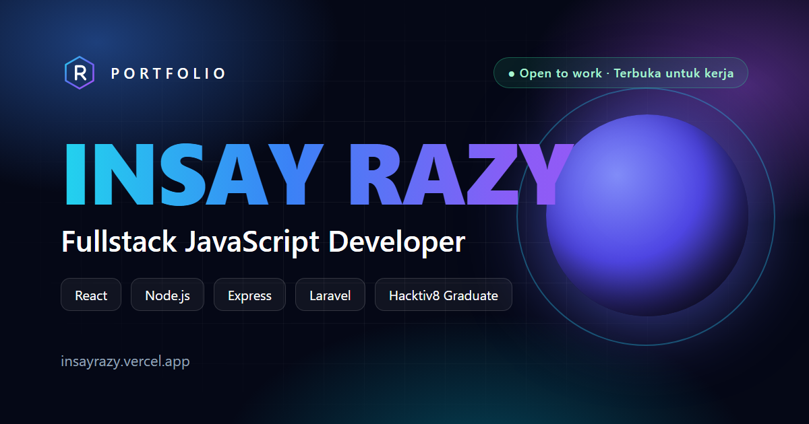

# INSAY RAZY — Premium Developer Portfolio

Website portfolio pribadi untuk **Insay Razy — Fullstack JavaScript Developer & lulusan Hacktiv8**, dibangun dengan React 19, Vite, Tailwind CSS, GSAP, Framer Motion, Lenis dan React Three Fiber. Fokusnya: kesan pertama yang kuat, animasi halus, aksesibilitas, dan performa.



---

## ✨ Fitur

| Area | Detail |
| --- | --- |
| **Intro** | Loading screen: logo stroke-draw, huruf brand, progress counter, panel curtain |
| **Background hidup** | Mesh gradient, aurora blobs, light beams, grid, floating glass shapes (mouse parallax), soft particles (canvas), noise texture |
| **Hero** | Nama INSAY RAZY dengan 3D character reveal, typing effect, orb 3D (React Three Fiber, lazy & desktop-only), orbit ikon teknologi, magnetic buttons, mouse scroll indicator |
| **Interaksi** | Cursor glow + cursor trail, magnetic button, card tilt + glare, spotlight hover, animated gradient border |
| **Scroll** | Lenis smooth scroll + GSAP ScrollTrigger (scrubbed text highlight di About, timeline progress, horizontal pinned scroll di Certificates), scroll progress bar |
| **Reveal** | Fade, slide, zoom, rotate, blur, mask, split-text — setiap section punya animasi berbeda |
| **Dwibahasa** | Bahasa Indonesia & English dengan toggle ID/EN di navbar; pilihan disimpan di browser, default mengikuti bahasa browser |
| **Routing** | `/` (home), `/projects` (arsip project + filter), `*` (404) dengan page transition curtain |
| **SEO** | Meta tags, Open Graph, Twitter Card, JSON-LD (Person, WebSite, ProfilePage), `sitemap.xml`, `robots.txt`, web manifest |
| **A11y** | Semantic HTML, skip link, keyboard navigation (tabs dengan arrow key, accordion Radix), ARIA labels, `prefers-reduced-motion` dihormati |
| **Performa** | Route-level code splitting, Three.js di chunk terpisah yang hanya dimuat di desktop, font self-hosted, lazy iframe/gambar, render 3D berhenti saat di luar viewport |

## 🧱 Tech Stack

- **Framework:** React 19, Vite 6, JavaScript (JSX)
- **Styling:** Tailwind CSS 3, shadcn/ui (versi JavaScript: Button, Accordion, Input, Textarea, Label, Badge, Card)
- **Routing:** React Router DOM 7
- **Animasi:** GSAP + ScrollTrigger (`@gsap/react`), Framer Motion, Lenis, React Three Fiber + Drei + Three.js
- **Ikon:** React Icons, Lucide React
- **Utility:** clsx, tailwind-merge, class-variance-authority

## 📁 Struktur Folder

```
Portfolio Insay Razy
├── public/                  # favicon, og-image, CV, robots.txt, sitemap.xml, manifest, _redirects
├── src/
│   ├── animations/          # easings, Framer variants, page transitions, GSAP setup & helpers
│   ├── assets/              # images (profile.svg), icons, videos, fonts
│   ├── components/
│   │   ├── background/      # AuroraBackground, FloatingShapes, ParticleField
│   │   ├── three/           # HeroScene (React Three Fiber)
│   │   ├── ui/              # shadcn/ui components (JS)
│   │   └── *.jsx            # Navbar, Loader, Reveal, SplitText, TiltCard, Magnetic, Counter, ...
│   ├── context/             # LoaderProvider, SmoothScrollProvider (Lenis), AppProviders
│   ├── data/                # SEMUA konten: site, skills, projects, experience, certificates, ...
│   ├── hooks/               # useTypewriter, useMagnetic, useTilt, useActiveSection, ...
│   ├── layouts/             # RootLayout
│   ├── pages/               # Home, ProjectsPage, NotFound
│   ├── router/              # AppRouter + lazy routes
│   ├── sections/            # Hero, About, Skills, TechStack, Experience, Projects, Certificates,
│   │                        # Services, Statistics, Testimonials, FAQ, Contact, Footer
│   ├── styles/              # base, components, utilities (Tailwind layers)
│   ├── utils/               # cn, helpers, constants
│   ├── App.jsx
│   ├── main.jsx
│   └── index.css
├── components.json          # konfigurasi shadcn/ui (tsx: false)
├── eslint.config.js
├── jsconfig.json            # alias @/ untuk editor
├── netlify.toml
├── postcss.config.js
├── tailwind.config.js
├── vercel.json
└── vite.config.js
```

Import menggunakan alias `@/` → `src/`, contoh: `import { site } from '@/data/site'`.

## 🚀 Instalasi & Menjalankan

Prasyarat: **Node.js 18.18+** (disarankan Node 20/22 LTS) dan npm. Kompatibel dengan Windows 11.

```bash
cd "C:\Users\LENOVO LOQ\Documents\Portfolio Insay Razy"

npm install

npm run dev
```

Buka `http://localhost:5173`.

| Script | Fungsi |
| --- | --- |
| `npm run dev` | Development server dengan HMR |
| `npm run build` | Build production ke folder `dist/` |
| `npm run preview` | Menjalankan hasil build secara lokal (`http://localhost:4173`) |
| `npm run lint` | Cek kode dengan ESLint |

## 🏗️ Build Production

```bash
npm run build
npm run preview
```

Hasil build berada di folder `dist/` dan siap di-deploy ke hosting statis mana pun.

## ☁️ Deployment

### Vercel

1. Push project ke GitHub.
2. Di [vercel.com](https://vercel.com) → **Add New → Project** → import repository.
3. Framework preset: **Vite** (otomatis). Build command `npm run build`, output `dist`.
4. Klik **Deploy**. `vercel.json` sudah mengatur SPA rewrite (agar `/projects` bisa di-refresh) dan cache header.

Atau via CLI:

```bash
npm i -g vercel
vercel
vercel --prod
```

### Netlify

1. Push project ke GitHub.
2. Di [app.netlify.com](https://app.netlify.com) → **Add new site → Import an existing project**.
3. Build command `npm run build`, publish directory `dist` (sudah diatur di `netlify.toml`).
4. Klik **Deploy**. SPA redirect sudah diatur lewat `netlify.toml` dan `public/_redirects`.

Atau via CLI:

```bash
npm i -g netlify-cli
netlify deploy --build
netlify deploy --build --prod
```

## ✏️ Kustomisasi Konten

Semua konten ada di `src/data/` — tidak perlu menyentuh komponen:

| File | Isi |
| --- | --- |
| `site.js` | Nama, role, email, telepon, lokasi, link sosial media, URL CV, embed Google Maps |
| `translations.js` | Semua teks UI (tombol, judul section, label form) dalam Bahasa Indonesia & Inggris |
| `about.js` | Narasi About Me, fakta, highlight |
| `skills.js` | Skill per kategori + persentase |
| `techStack.js` | Logo teknologi (marquee & grid) |
| `experience.js` | Timeline pengalaman |
| `projects.js` | Project (tambahkan `image` untuk screenshot asli) |
| `certificates.js` | Kredensial Hacktiv8 (link sertifikat & transkrip nilai) dan kurikulum |
| `services.js`, `statistics.js`, `testimonials.js`, `faq.js` | Konten section terkait |

### ⚠️ Wajib diganti sebelum dipublikasikan

- **Foto profil:** ganti `src/assets/images/profile.svg` dengan foto asli (mis. `profile.webp`, 800×800) lalu ubah import di `src/data/site.js`.
- **CV:** tombol Unduh CV membuka file CV di Google Drive (`cvUrl` di `src/data/site.js`). Pastikan file tetap dibagikan "Anyone with the link".
- **Data contoh:** testimoni, statistik, link project, username GitHub/LinkedIn, dan nomor WhatsApp saat ini adalah **contoh** — sesuaikan dengan data asli.
- **Link Hacktiv8:** sertifikat & transkrip ada di `src/data/certificates.js` — pastikan kedua file Google Drive dibagikan "Anyone with the link".
- **Domain:** jika domain bukan `https://insayrazy.vercel.app`, ganti di `index.html`, `public/robots.txt`, `public/sitemap.xml` dan `src/data/site.js`.
- **OG image:** `public/images/og-image.png` (1200×630) bisa diganti dengan desain sendiri.

### Form kontak

Secara default form membuka aplikasi email pengunjung (`mailto:`). Untuk mengirim langsung, buat endpoint (mis. [Formspree](https://formspree.io)), salin `.env.example` menjadi `.env`, lalu isi:

```env
VITE_CONTACT_ENDPOINT=https://formspree.io/f/xxxxxxx
```

Di Vercel/Netlify, tambahkan variabel yang sama di pengaturan Environment Variables.

### Menambah komponen shadcn/ui

`components.json` sudah dikonfigurasi untuk JavaScript (`"tsx": false`):

```bash
npx shadcn@latest add dialog
```

## ♿ Aksesibilitas & Motion

- Pengguna dengan `prefers-reduced-motion` mendapat versi tanpa smooth scroll, partikel, cursor effect, scene 3D, dan pinning.
- Cursor glow/trail dan efek tilt/magnetic hanya aktif di perangkat dengan mouse/trackpad.

## 📄 Lisensi

© Insay Razy. Kode bebas digunakan sebagai referensi; konten pribadi (nama, foto, CV) milik pemiliknya.

## 🌐 Dwibahasa (Indonesia / English)

- Toggle **ID / EN** ada di navbar. Pilihan disimpan di `localStorage`; kunjungan pertama mengikuti bahasa browser (default: Indonesia).
- Teks UI ada di `src/data/translations.js` (`t('hero.viewProjects')`).
- Konten di file data memakai format `{ en: '...', id: '...' }` dan dibaca dengan `tr(value)` dari hook `useI18n()`.
- Menambah teks baru: tambahkan key yang sama di blok `en` dan `id` pada `translations.js`.
